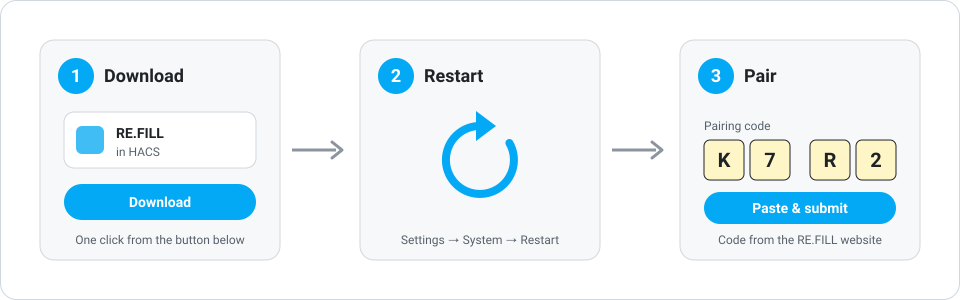
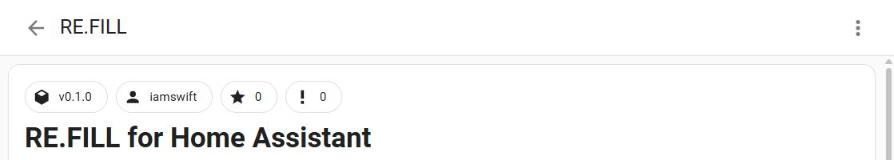
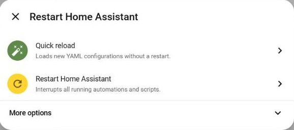
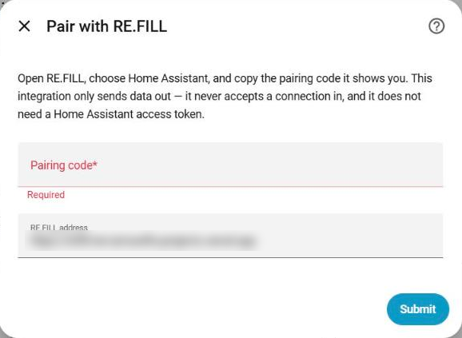

# RE.FILL for Home Assistant

**Never get caught by a dead battery or a clogged filter again.**

[RE.FILL](https://refill-me-five.vercel.app/) tracks what your smart home runs
out of — batteries, filters, pods, vacuum bags — and tells you before it does.

- **See what runs out next.** One list of every device that needs something,
  ordered by how soon. No more walking round the house checking.
- **Forecasts, not guesses.** RE.FILL learns how fast each device actually uses
  its battery or filter, and works out how many days are left.
- **A heads-up in time to order.** You get a reminder like *"order AA by
  Friday"* while there's still time for the delivery to arrive.
- **Knows the part.** It works out which battery or filter each device takes,
  so you're not hunting for model numbers.
- **Private by design.** RE.FILL reads consumable levels and nothing else — not
  your locks, cameras or who's home.
- **Free, and set up in minutes.** Works alongside the apps you already use.

**[Get started at RE.FILL →](https://refill-me-five.vercel.app/)**

## What this integration does

This integration sends the consumable levels Home Assistant already knows — battery percentages,
filter life — out to RE.FILL, so it can tell you what runs out next and reorder
before it does.

**It only sends.** This integration opens no port, registers no webhook and
accepts no inbound connection. Nothing outside your house can reach it.

## Set up in 3 steps



**Before you start:** have the RE.FILL pairing screen open (it shows an
8-character code), and make sure [HACS](#dont-have-hacs-yet) is installed in
Home Assistant.

### 1. Download RE.FILL

Click this button. It opens your own Home Assistant, straight to RE.FILL in HACS:

[](https://my.home-assistant.io/redirect/hacs_repository/?owner=iamswift&repository=refill-homeassistant&category=integration)

You'll land on the RE.FILL page in HACS:



Click **Download** (bottom right), then **Download** again to confirm.

> The first time you use a button like this, it asks for your Home Assistant's
> address (for example `http://homeassistant.local:8123`). It remembers it after that.

### 2. Restart Home Assistant

**Settings → System →** the **⏻** button top right **→ Restart Home Assistant**.
Wait a minute for it to come back.



Choose **Restart Home Assistant**. *Quick reload* is not enough.

### 3. Pair with RE.FILL

Click this button:

[](https://my.home-assistant.io/redirect/config_flow_start/?domain=refill)

A **Pair with RE.FILL** box opens:



Paste the code from the RE.FILL pairing screen into **Pairing code** and click
**Submit**. Leave **RE.FILL address** as it is. Within a minute, the RE.FILL screen changes from
*Waiting for your hub…* to connected. You're done.

### Something not right?

| What you see | What to do |
| --- | --- |
| The step 1 button doesn't open HACS | Install HACS first — see below. |
| **RE.FILL** isn't in the *Add integration* list | Restart Home Assistant (step 2), then try step 3 again. |
| *"That code was not accepted…"* | Codes last 10 minutes and work once. Get a fresh one on the RE.FILL screen and paste it again. |
| *"Could not reach RE.FILL…"* | Home Assistant can't reach the internet. Check its connection and try again. |
| *"This hub is already paired with RE.FILL."* | Nothing to do — it's already connected. |

<details>
<summary><b>Don't have HACS yet?</b></summary>

<a id="dont-have-hacs-yet"></a>
HACS is a free add-on store for Home Assistant. You set it up once.
These steps are for **Home Assistant OS** (Green, Yellow, Raspberry Pi, or a
virtual machine). On other installs, follow
[the HACS guide](https://hacs.xyz/docs/use/download/download/).

1. **Settings → Add-ons** (called **Apps** on newer versions) **→ Add-on store**.
2. **⋮** top right **→ Repositories**, paste `https://github.com/hacs/addons`,
   click **Add**, then **Close**.
3. Open **Get HACS**, click **Install**, then **Start**. Wait until its
   **Log** tab says it's finished.
4. Restart Home Assistant (as in step 2 above).
5. **Settings → Devices & services → Add integration → HACS**. Tick the boxes,
   then follow the link to GitHub and enter the code it shows you.
6. **HACS** now appears in the sidebar. Go back to step 1.

</details>

<details>
<summary><b>Prefer not to use HACS?</b></summary>

Copy the `custom_components/refill` folder from this repository into your
Home Assistant `config/custom_components/` folder (the **File editor** or
**Samba share** add-on both work), restart, then do step 3. You won't get
update notifications this way.

</details>

## Why there is no access token

Home Assistant's long-lived access tokens are **unscoped admin credentials**.
There is no read-only variant: a token that can read a battery percentage can
also unlock your doors, watch your cameras and read every automation you have
ever written.

RE.FILL tells people, on four separate screens, that it reads consumable levels
and stops there. Holding a credential that could do all of the above would make
that claim untrue no matter how carefully the code behaved — the promise would
rest on our restraint rather than on anything you could check.

So the direction is inverted. This integration runs *inside* Home Assistant,
where it already has access, and pushes out the narrow thing RE.FILL needs. The
credential it holds is a RE.FILL token, scoped to one connection, and the only
thing that token can do is append readings. It cannot read your account.

## What gets sent

`custom_components/refill/collector.py` is the whole answer, and it is short
enough to read in full. It is an **allowlist**, not a redaction: an entity
contributes a number only if that number is a consumable level.

Sent, per device:

- Battery percentage (`device_class: battery`, reporting `%`)
- Filter life percentage — from a sensor whose name says so, or from a
  `filter_life_remaining` attribute on a fan, vacuum or humidifier
- Its name, room, manufacturer and model, so RE.FILL can work out which part it takes
- Its Zigbee/Z-Wave/Matter identity, which is what lets RE.FILL tell that the
  lock your hub sees and the lock some other app sees are one lock
- When Home Assistant last saw that level change

Not sent — and there is a test for each:

- Lock, cover, alarm or switch state
- Cameras, in any form
- Presence, device trackers, person entities
- Temperature, humidity, power, energy, air quality
- Any entity you have disabled or hidden
- Any percentage that is not a consumable level — speaker volume and humidity
  are both `%`, and neither is a thing you reorder

A device that reports only a *low battery* boolean sends nothing. Turning `on`
into "10%" would put a number your device never reported into a ledger that
RE.FILL runs a regression over, and a forecast built on an invented number is
worse than no forecast.

An unavailable sensor sends nothing either — never `0`, which would read as
"empty" and order you batteries you don't need.

## How often

| | |
| --- | --- |
| Full report | hourly |
| Heartbeat | every 15 minutes |

The heartbeat exists so RE.FILL can tell "nothing changed" apart from "this hub
has been unplugged since Tuesday". If it stops hearing from you for six hours,
your connection shows as degraded and the dashboard starts showing levels with
the date they were read, rather than pretending they are current. Plug the hub
back in and it recovers on its own — there is nothing to reconnect.

`refill.sync_now` reports immediately, which is handy right after you swap a set
of batteries.

## If it stops working

If the pairing is revoked from RE.FILL, the integration will show as needing
attention and ask for a new pairing code. Your device history is kept: the
readings were facts about your house, not about the connection.

## Tests

```bash
python3 tests/test_collector.py
```

No Home Assistant install needed — the registries are stubbed. The tests worth
reading are the ones that put a lock, a camera and a thermostat in front of the
collector and check that nothing comes out.

## License

Released under the MIT license (see `LICENSE`). The license covers this
repository only, not the rest of the RE.FILL project.
